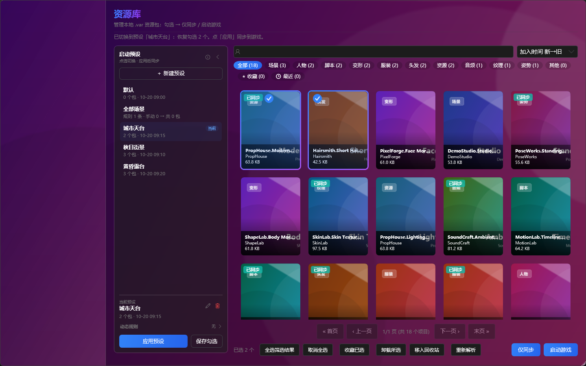
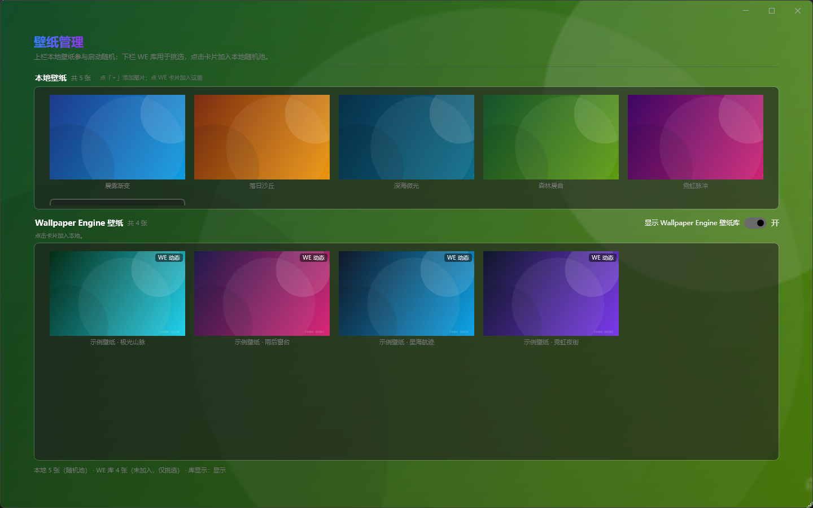

<p align="center">
  
</p>

<p align="center">
  <b>一款简洁高效的 Virt-A-Mate 资源包管理工具</b><br/>
  <sub>资源按需加载 · 依赖自动补齐 · 动态启动预设</sub>
</p>

<p align="center">
  <a href="../../releases/latest"></a>
  <a href="../../releases"></a>
  
  
</p>

<p align="center">
  
</p>

**VAM-BEGIN** 面向 Virt-A-Mate 玩家：把散落在游戏目录里的 `.var` 资源集中到本地库统一管理，按需「仅同步 / 启动游戏」；预设依赖自动补齐、启动预设一键切换，让游戏目录始终只保留当前要用的资源。程序为绿色版，解压即用，配置与资源库存放在任意你指定的目录。

> [!IMPORTANT]
> **官方唯一下载渠道：[GitHub Releases](../../releases)**（仓库 `V-Sama/VAM-BEGIN`）。本软件**免费**，**任何收费售卖均非官方**：网盘分享、淘宝 / 拼多多代购、软件下载站、公众号 / QQ 群转发的「绿色版 / 汉化版 / 破解版」均未经授权，可能被替换、捆绑恶意程序或植入后门。请只从本仓库 Releases 下载；从其他渠道获取的安装包请勿运行，更不要向任何商家付费购买。

> 下方功能详解中穿插了实际界面截图，点击图片可查看大图。

---

## ✨ 功能一览

<!-- sync:features-begin -->
- 🎮 **首页 · 一键启动** — 桌面 / VR 一键启动 · 拖拽导入 · 自动收编 · 空闲自动隐藏
- 🧠 **启动预设与动态规则** — 手动勾选与动态规则 · 切换即整套换包 · 严格按需收敛
- 📚 **资源库 · 按需加载** — 搜索 · 作者筛选 · 分类 · 收藏 · 自定义标签 · 悬停大预览
- 🕹 **游戏库 · 已装包总览** — 已装包总览 · 状态徽章 · 恢复上次选择 · 右键卸载
- 🖼 **壁纸页 · 本地随机池与 WE 挑选区** — 本地随机池 · WE 挑选区 · 视频全页面播放 · GIF 默认循环
- 🧩 **预设依赖管理** — 缺 N 徽章 · 一键补齐 · 在线下载 · 缺失依赖报告 · 反向依赖
- 🗂 **管理本地包与维护工具** — 空间统计 · 预览缓存 · 维护三页签 · 库间迁移 · 备份
- ⚙ **设置与个性化** — 路径 · 同步方式 · 启动行为 · 窗口大小 · 主题 · 更新
<!-- sync:features-end -->

> 完整更新记录见 [CHANGELOG.md](CHANGELOG.md)。

---

## 🚀 快速开始

### 环境要求

- Windows 10 / 11
- [.NET 8.0 Desktop Runtime](https://dotnet.microsoft.com/download/dotnet/8.0)

### 安装与使用

1. 从 [Releases](../../releases) 下载最新版本（**唯一官方渠道**，本软件免费，请勿付费购买）
2. 解压后运行 `VamBegin.exe`
3. 把鼠标移到窗口左边缘，点击出现的箭头打开侧栏，进入 **设置 → 常规设置**
4. 配置以下路径（修改后自动保存）：
   - **游戏安装路径** — Virt-A-Mate 游戏根目录，用于启动游戏和复制依赖
   - **本地 Var 包路径** — 存放 .var 资源包的目录；建议与游戏目录分开，不设置则默认使用程序目录下的 `AddonPackages`
5. 回到 **资源库**，勾选要用的资源 →「仅同步」或「启动游戏」

> 💡 也可以直接把 .var 文件、.zip 压缩包或整个文件夹拖进窗口导入。
> 💡 应用内「帮助 → 教程」提供完整图文流程，第一次使用可以先看一遍。

### 推荐流程

```text
最简：设置路径 → 资源库勾选 →「仅同步」/「启动游戏」
日常：主页选好启动预设 →「启动游戏」（启动前自动补齐预设依赖）
导入：拖入 .var / .zip / 文件夹 → 去重入资源库 → 确认同步到游戏库
大库：资源库维护（整理去重 / 损坏包检测）→ 库间迁移 → 回收站清理
```

> 无论资源以何种方式进入游戏库（拖拽导入 / 手动放入），都会在启动时被自动收编进资源库统一管理。
> 首次使用建议把资源库放在游戏目录之外；若资源库路径落在程序目录内，启动时会通过路径自检提醒迁移。

---

## 📖 功能详解

<!-- sync:detail-begin -->
### 🎮 首页 · 一键启动

<p align="center">
  <a href="images/screenshot-home.png"></a><br/>
  <sub>首页：桌面 / VR 一键启动，可直接选择当前启动预设</sub>
</p>

一键启动的主界面：切换桌面 / VR 模式、选择启动预设并启动游戏，支持拖拽导入与启动前自动收编；离开窗口超过 10 秒后内容自动淡出，只留壁纸。

- 桌面模式与 VR 模式（OpenVR）一键切换，点击「启动游戏」直接启动 Virt-A-Mate。
- 启动按钮下方可选择当前启动预设，启动时自动应用、同步并补齐依赖。
- 启动前自动收编游戏目录中未入库的 .var；「默认」预设会把收编的包同步回游戏库。
- 游戏库里还有未入库资源时，状态行会提示启动时自动迁移到资源库。
- 把 .var 文件、.zip 压缩包或整个文件夹拖进窗口即可导入，随后询问是否同步到游戏库。
- 加密 zip 会弹出密码框，支持 ZipCrypto、WinZip AES 与中文密码，输错可重试。
- 窗口失焦或鼠标移出超过 10 秒后，中央内容、拖拽提示与窗口按钮一起淡出（约 450ms），只留壁纸。
- 重新激活窗口或把鼠标移回后约 280ms 淡入；应用自身的弹窗和文件选择框不算离开。
- 点击标题「VAM-BEGIN」可随机换一张壁纸；窗口右边缘的箭头可打开资源库抽屉。

### 🧠 启动预设与动态规则

<p align="center">
  <a href="images/screenshot-launch-presets.png"></a><br/>
  <sub>资源库左侧「启动预设」面板：选中的预设带「当前」标记，切换只改勾选，「应用预设」或启动时才同步</sub>
</p>

启动预设把「这次要玩的一批包」保存成命名方案，由手动勾选与动态规则共同定义；点选预设只切换勾选，应用预设或启动游戏时才同步到游戏库。

- 预设由手动勾选的包与动态规则命中的包共同定义，两者一起决定启动内容。
- 规则支持作者、类型、收藏、缺依赖四个维度，可勾选反选从集合中排除。
- 规则命中的包在资源库自动勾选并带锁定徽标，只能通过修改或删除规则移除。
- 点选预设只切换勾选并设为当前预设，不会立刻同步到游戏库。
- 「应用预设」会先保存当前手动勾选，再同步到游戏库（选中进 MainPak、依赖进 Dp）。
- 常驻的「默认」预设不可删除或改名，不触发严格收敛，可作为不筛选的兜底。
- 切换预设前若有未保存的手动勾选，会提示「保存并切换」或「不保存」。
- 应用预设时开启「清理游戏库」会把不属于当前预设及依赖的库镜像移出游戏库（库内保留、静默执行）。
- 作者出新包、重新解析标签或收藏变化后，规则命中会自动重算。

> 💡 规则优先于手动：同时命中规则的包也保持只读勾选，要调整只能修改或删除规则。

### 📚 资源库 · 按需加载

<p align="center">
  <a href="images/screenshot-library.png"></a><br/>
  <sub>资源库：左侧启动预设栏与卡片浏览，勾选后仅同步或启动</sub>
</p>

日常使用的核心工作台：浏览本地 .var 资源，用搜索、作者与分类筛选快速定位，勾选本次要用的包后「仅同步」或直接启动游戏。

- 搜索文件名，按类型筛选场景、人物、脚本、服装、头发、资源、音频、纹理、姿势等。
- 作者筛选在搜索框左侧，输入即过滤，并附带该作者的资源类型统计。
- 支持收藏、最近使用、自定义标签、排序与分页；标签按「作者.包名」共享，换库路径不丢。
- 悬停卡片会浮层显示包内高清大预览，后台加载不阻塞列表。
- 左上角绿色「已同步」角标标记已在游戏库中的资源，同步或卸载后即时刷新。
- 勾选后「仅同步」只写入游戏库，「启动游戏」同步后切回首页并启动；点选卡片不刷新列表。
- 批量操作：全选筛选结果、取消全选、收藏已选、卸载所选、移入回收站。
- 右键菜单支持收藏、自定义标签、查看详情（含反向依赖）、Hub 搜索、打开文件夹、卸载与移入回收站。
- 「重新解析」重建预览图与标签，解析中可以随时取消；已勾选的包会在翻页或筛选后置顶。

> 💡 卸载只从游戏移除，本地库副本保留；移入回收站的原件在保留期内可恢复。

### 🕹 游戏库 · 已装包总览

<p align="center">
  <a href="images/screenshot-game-library.png"></a><br/>
  <sub>游戏库：浏览游戏目录中已安装的包与来源状态徽章</sub>
</p>

独立查看游戏 AddonPackages（含 Dp）中实际已安装的包，用状态徽章区分来源，并可直接卸载、恢复上次勾选或查看依赖关系。

- 列出游戏目录中已安装的 .var，含 Dp 依赖目录，无需回到资源库操作。
- 状态徽章区分「已添加」（由资源库同步）与「手动放入」（直接放进游戏目录）。
- 支持搜索、分类筛选、收藏、最近、排序、分页与批量选择。
- 底部「恢复上次选择」可恢复上次在游戏库中的勾选结果。
- 右键可卸载、查看详情（含反向依赖）、在 Hub 搜索、打开所在文件夹。
- 卸载前展示依赖树预览，从游戏移除但保留本地库副本；孤儿依赖库内已有同名则删游戏副本，否则移回资源库。
- 收藏与资源库互通，换路径或跨版本不丢。

### 🖼 壁纸页 · 本地随机池与 WE 挑选区

<p align="center">
  <a href="images/screenshot-wallpaper.png"></a><br/>
  <sub>壁纸页：上栏本地随机池、下栏 Wallpaper Engine 挑选区，点击卡片即可加入</sub>
</p>

管理应用背景壁纸：上栏「本地壁纸」参与启动随机，下栏 WE 挑选区点选后加入随机池；视频壁纸默认在所有页面实时播放，仅最小化时暂停。WE 挑选区只列可播放的视频壁纸（场景/网页壁纸不支持）。

- 上栏「本地壁纸」是启动随机池，点「＋」可添加本地图片，删除只移出列表不删文件。
- 下栏 WE 挑选区只列出可播放的视频壁纸（场景/网页壁纸由 WE 引擎渲染、无法实时显示，已不再列出），点击卡片即加入随机池并移到上栏。
- WE 条目只引用 WE 库原文件，不复制、不占额外空间，也不改动或删除原文件。
- 在本地删除 WE 条目后它会回到挑选区，可再次点选加入。
- 页头「显示 Wallpaper Engine 壁纸库」开关只控制挑选区显示或隐藏，不影响随机池。
- 卡片预览默认循环播放 preview.gif（仅可见卡片、限并发）；没有 GIF 时保持静态。
- WE 挑选区默认按订阅时间从新到旧排序；条目失效时标灰「当前不可用」，恢复后自动可用。
- 视频壁纸默认在所有页面实时播放，仅窗口最小化时暂停；静态壁纸在内容页为模糊背景。
- 视频壁纸声音默认关闭，可在设置 → 常规设置 →「壁纸声音」开启并调音量；GIF 预览始终无声。

> 💡 修改会即时保存，无需手动保存；列表为空或全部失效时使用内置默认壁纸，下次启动仍会重新随机挑选。

### 🧩 预设依赖管理

<p align="center">
  <a href="images/screenshot-presets.png"></a><br/>
  <sub>预设依赖管理：缺失依赖徽章、依赖分析与补齐入口</sub>
</p>

分析场景（.json）与外观（.vap）预设引用的 var 包，标出缺失依赖并支持单个或一键补齐到游戏 Dp，缺的免费包可从 Hub 在线下载。

- 扫描场景（.json）与外观（.vap）预设引用的 var 包，卡片红色「缺 N」徽章标出缺失数。
- 支持全部、场景、外观、服装、皮肤、其他筛选，可按缺失数排序并只看缺失。
- 选中预设后点「分析选中预设的依赖」，查看完整依赖列表与缺失项。
- 依赖状态区分在游戏中、游戏内无（仅本地库）与缺失（游戏与库都没有）。
- 「补齐全部依赖」把本地可解析的依赖复制到游戏 Dp 目录；右键可补齐单个预设。
- 「在线补齐」通过 Hub 客户端接口自动下载缺失的免费包，无需 Hub 账号；遇到受限资源/风控提示时再到常规设置填写会话 Cookie。
- 「检测可下载」给缺失项打上可下载、需登录、付费、需人工确认、未找到等标记。
- 「缺失依赖报告」全局汇总所有预设引用的缺失依赖，可批量处理。
- 包详情的「被谁需要」可展开反向依赖，改动前先看清影响范围。

> 💡 预设清单里的旧路径会自动按库内同名文件重定位，整理归档后通常无需手动修改预设。

### 🗂 管理本地包与维护工具

<p align="center">
  <a href="images/screenshot-tools.png"></a><br/>
  <sub>资源管理：空间统计、预览缓存、库间迁移与维护入口</sub>
</p>

管理本地 .var 的维护工具页：统计磁盘占用、清理预览缓存、双向迁移库文件、整理去重与备份，帮助控制游戏目录与资源库的体积。

- 空间统计以扇形图展示本地库、回收站与游戏目录的包数和占用，附作者占用 Top3。
- 预览缓存显示占用、文件数与上限（默认 500MB），超限自动淘汰最旧文件，可一键清理。
- 场景依赖体检扫描游戏场景引用的 var 包，反查本地缺失并生成「场景依赖报告.md」。
- 库间迁移支持迁移到本地（释放游戏目录）与回迁到游戏（便于加载），回迁时同名文件自动跳过。
- 资源库维护窗口三个页签按需执行：整理去重、损坏包检测、孤儿依赖。
- 整理前会确认待清理的垃圾文件，完成后展示统计与整理日志；所有移除项进入软回收站。
- 一键备份把程序配置与完整依赖清单（含本地缺失标记）打包到带时间戳的目录。
- 「导出依赖清单」单独生成依赖清单.md，可直接分享给他人对照补齐。
- 回收站集中存放整理产生的重复与无效文件，保留期内可恢复，也可一键清理过期文件。

### ⚙ 设置与个性化

<p align="center">
  <a href="images/screenshot-settings.png"></a><br/>
  <sub>常规设置：路径、同步方式、启动行为、主题与版本更新</sub>
</p>

集中管理路径、同步方式、启动行为、窗口大小、主题、壁纸声音与版本更新；多数选项修改后立即生效并自动保存。

- 游戏安装路径与本地 Var 包路径在本页配置，修改后自动保存并即时检查有效性。
- 同步方式可选自动（同盘硬链接、跨盘或失败回退复制）或强制复制（独立文件）。
- 启动行为三项开关：启动前补齐预设依赖、跳过散落资源自动收编、切换预设时清理游戏库。
- 启动窗口大小可选常见分辨率或自定义；自定义会记住调整后的尺寸与最大化状态。
- 界面主题支持浅色、深色与跟随系统，切换即时生效，新装默认跟随系统。
- 壁纸声音默认关闭，可开启视频壁纸音轨并调节音量；GIF 预览始终无声。
- 首次使用引导可随时重跑；引导中途退出或强杀，下次启动会从上次步骤继续。
- 数据备份把资源库全部 .var 增量复制到指定目录；Hub 代理与 Cookie、回收站保留期也在本页。
- 版本与更新可一键比对 GitHub 最新版本；官方唯一下载渠道为 GitHub Releases，本软件免费。

> 💡 自动模式在同盘使用硬链接，库与游戏两侧是同一份数据；需要独立副本时改用强制复制。

<!-- sync:detail-end -->

---

## ❓ 常见问题

**Q: 启动时提示「游戏路径未配置」？**
> 打开侧栏 → 设置 → 常规设置，配置 Virt-A-Mate 游戏的根目录。

**Q: 勾选了资源，进游戏却看不到？**
> 同步会把选中包放到 `AddonPackages\MainPak`（同盘默认硬链接、不占额外空间；跨盘或失败才复制为独立文件），依赖放到 `Dp`。如果依然看不到，请确认游戏目录 `AddonPackages` 根目录下没有散落的 .var——下次启动时会自动收编入库。

**Q: 为什么切换预设后，游戏库里的包变少了？**
> 这是「严格按需收敛」：应用预设时，不属于当前预设及其依赖、且资源库中已有同名副本的包会被移出游戏库（资源库内保留，随时可重新勾选）。游戏独占文件不会被清理，「默认」预设不触发收敛；也可在常规设置中关闭「切换启动预设时清理游戏库」。

**Q: 启动预设和手动勾选是什么关系？**
> 预设 = 手动勾选 + 动态规则。规则命中的包自动进入预设且勾选只读，手动勾选部分可随时调整；点选预设只切换勾选，点「应用」或启动游戏才会同步。

**Q: 预览图加载很慢或没有图？**
> 预览解析会自动增量进行；也可以点资源库工具栏的「重新解析」手动重建缓存。

**Q: 拖入加密 zip 提示输入密码？**
> 支持 ZipCrypto 与 WinZip AES 加密，中文密码（UTF-8 / GBK / ANSI / Big5）也可以直接输入；密码在本次会话内记忆，输错可重试。

**Q: 整理或清理会删掉我的资源吗？**
> 不会直接删除。重复、损坏与冗余文件都会移入回收站（`VAMB_RecycleStation`），保留期内可随时恢复，保留期可在设置中调整。

**Q: 依赖缺失怎么办？**
> 打开「预设依赖管理」，用「补齐全部依赖」复制本地可解析的依赖，或用「在线补齐」自动定位 / 下载；跨预设的整体缺失情况可看「缺失依赖报告」。

**Q: 如何备份配置和资源库？**
> 常规设置 →「数据备份」把资源库全部 .var 增量备份到指定磁盘；资源管理 →「备份」把程序配置与依赖清单打包；收藏 / 标签 / 预设另有快照自动恢复。

**Q: 如何检查新版本？**
> 设置 → 常规设置 →「版本与更新」→「检查更新」，会自动比对 GitHub 最新 Release 并跳转下载页。

---

> 如果这个项目对你有帮助，欢迎点一个 ⭐ Star；使用中遇到问题或有建议，欢迎在 [Issues](../../issues) 反馈。
