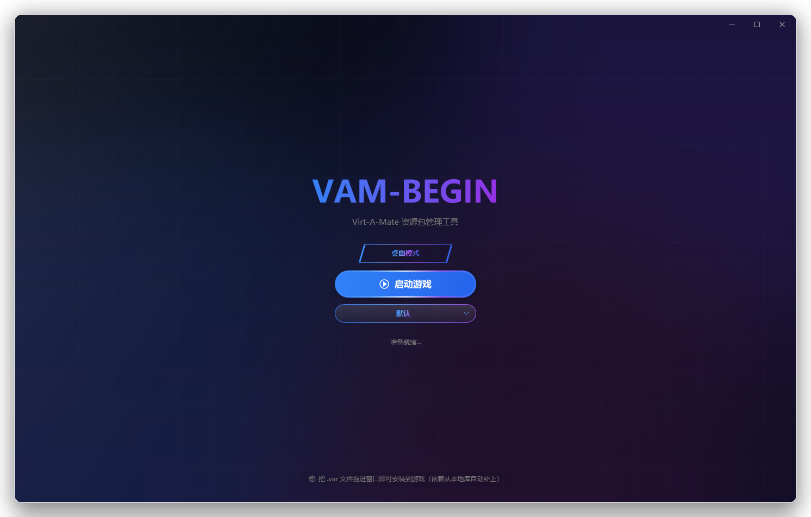
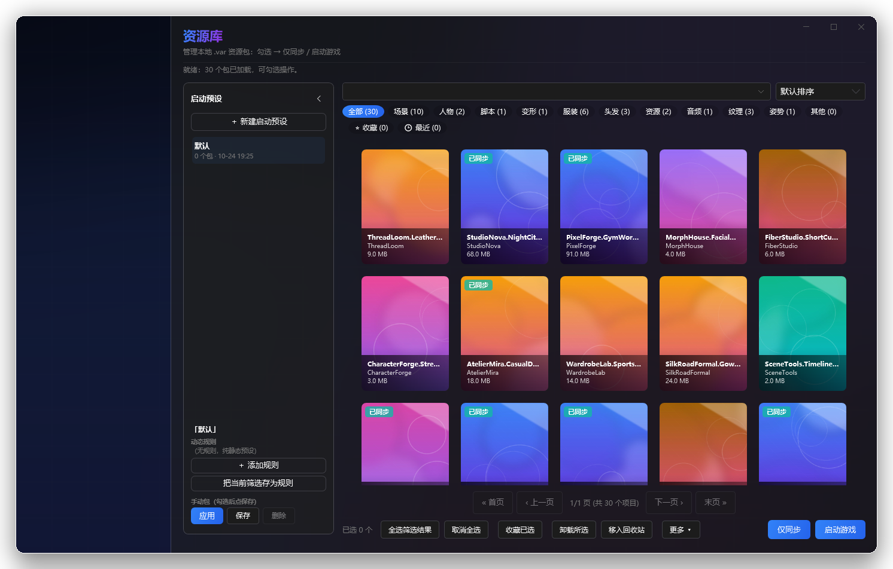
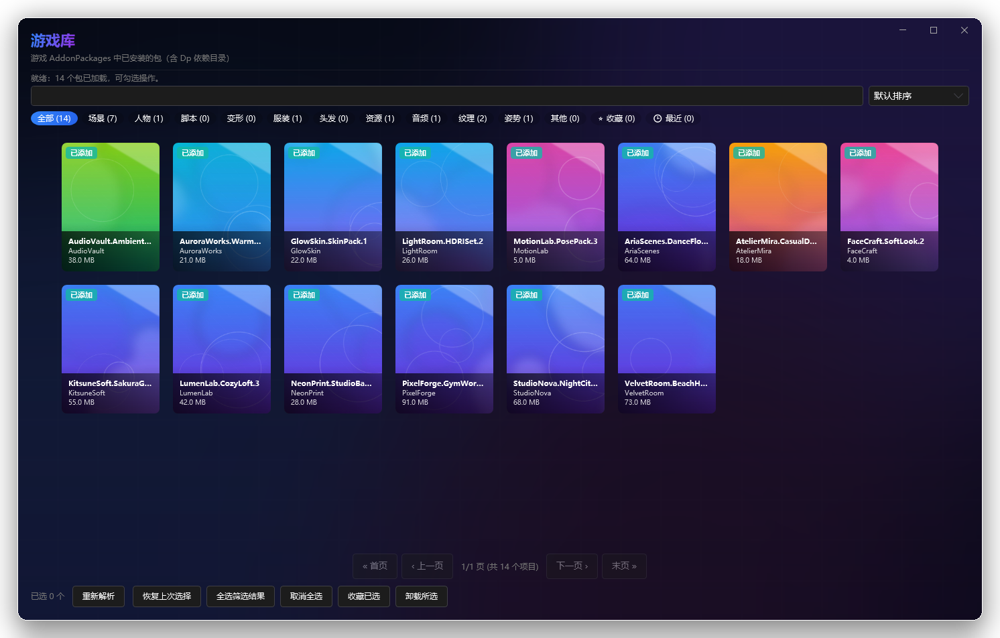
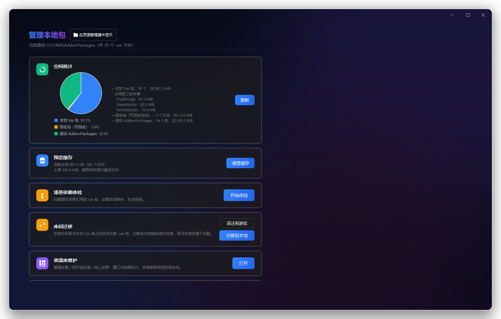
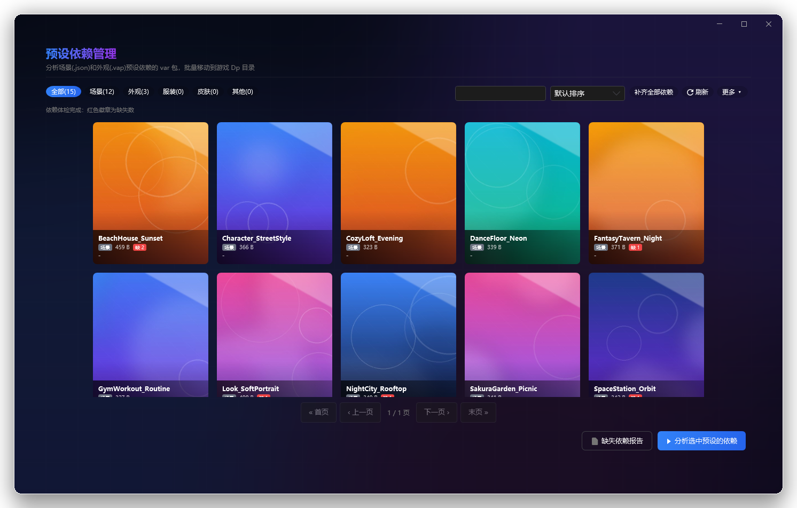
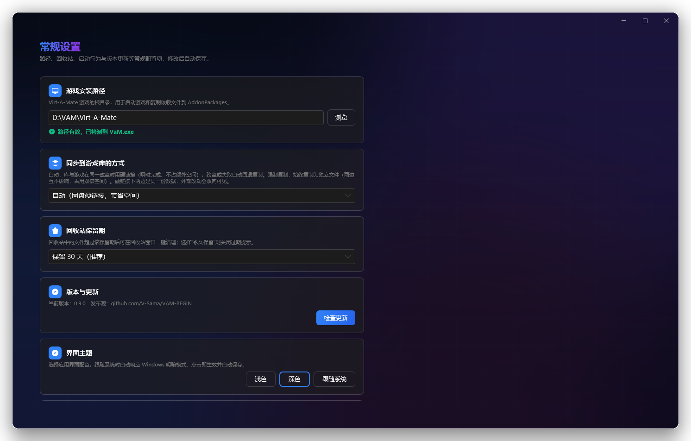

<p align="center">
  
</p>

<p align="center">
  <b>一款简洁高效的 Virt-A-Mate 资源包管理工具</b><br/>
  <sub>资源按需加载 · 依赖自动补齐 · 动态启动预设</sub>
</p>

<p align="center">
  <a href="../../releases/latest"></a>
  <a href="../../releases"></a>
  
  
</p>

<p align="center">
  
</p>

**VAM-BEGIN** 面向 Virt-A-Mate 玩家：把散落在游戏目录里的 `.var` 资源集中到本地库统一管理，按需「仅同步 / 启动游戏」；预设依赖自动补齐、启动预设一键切换，让游戏目录始终只保留当前要用的资源。程序为绿色版，解压即用，配置与资源库存放在任意你指定的目录。

---

## 🖼 界面预览

> 以下为应用内实际界面截图，点击图片可查看大图。

<table align="center">
  <tr>
    <td align="center" width="50%">
      <a href="images/screenshot-home.png"></a><br/>
      <sub>首页 · 一键启动</sub>
    </td>
    <td align="center" width="50%">
      <a href="images/screenshot-library.png"></a><br/>
      <sub>资源库 · 按需加载</sub>
    </td>
  </tr>
  <tr>
    <td align="center" width="50%">
      <a href="images/screenshot-game-library.png"></a><br/>
      <sub>游戏库 · 已装包总览</sub>
    </td>
    <td align="center" width="50%">
      <a href="images/screenshot-tools.png"></a><br/>
      <sub>资源管理 · 统计与维护</sub>
    </td>
  </tr>
  <tr>
    <td align="center" width="50%">
      <a href="images/screenshot-presets.png"></a><br/>
      <sub>预设依赖管理</sub>
    </td>
    <td align="center" width="50%">
      <a href="images/screenshot-settings.png"></a><br/>
      <sub>常规设置</sub>
    </td>
  </tr>
</table>

---

## ✨ 功能一览

- 🧠 **动态启动预设** — 手动勾选 + 动态规则（作者 / 资源类型 / 收藏 / 缺依赖，可反选）混合定义，切换预设即切换整套勾选
- 🎮 **一键启动** — 桌面模式 / VR 模式（OpenVR）；主页预设下拉选好预设直接启动
- 📚 **资源库工作台** — 搜索、作者筛选、分类、收藏 / 最近 / 自定义标签，悬停大预览，批量勾选后「仅同步」或「启动游戏」
- 🕹 **游戏库** — 一级页面总览游戏 AddonPackages（含 Dp）中已安装的包，状态徽章、搜索排序、收藏与卸载
- 🖱 **拖拽导入** — .var 文件 / 文件夹直接拖入；.zip 自动扫描解包，支持 WinZip AES 加密与中文密码
- 🔎 **自动收编** — 启动时嗅探游戏目录中的散落资源，自动移动入库并同步回游戏库
- 🧩 **预设依赖管理** — 场景 / 外观预设依赖分析，红色「缺 N」徽章，单个或一键补齐到游戏 Dp
- 🔗 **反向依赖** — 包详情显示「被谁需要」，改动之前先看清牵连范围
- ⚠️ **缺失依赖报告** — 全局扫描预设引用，标出游戏与资源库中都没有的依赖及可得性，支持在线补齐
- 🗑 **卸载 / 移入回收站** — 卸载前依赖树预览、自动处理孤儿依赖；库内资源可移入回收站并在保留期内恢复
- 🗂 **资源库维护** — 整理去重 / 损坏包检测 / 孤儿依赖三页签，一键去重、清理损坏包，移除项全部进软回收站
- 🗃 **库间迁移** — 游戏目录与本地库双向迁移，同名文件自动跳过
- 💾 **数据安全** — 收藏 / 标签 / 预设快照自动恢复、库路径自检、一键备份与依赖清单导出
- 📊 **空间统计与预览缓存** — 扇形图展示库 / 回收站 / 游戏目录占用与作者 Top3；缓存上限与一键清理
- 🔄 **检查更新** — 一键比对 GitHub 最新版本并跳转下载页
- 🎨 **个性化** — 浅色 / 深色 / 跟随系统主题，自定义壁纸随机轮换

> 完整更新记录见 [CHANGELOG.md](CHANGELOG.md)。

---

## 🚀 快速开始

### 环境要求

- Windows 10 / 11
- [.NET 8.0 Desktop Runtime](https://dotnet.microsoft.com/download/dotnet/8.0)

### 安装与使用

1. 从 [Releases](../../releases) 下载最新版本
2. 解压后运行 `VamBegin.exe`
3. 把鼠标移到窗口左边缘，点击出现的箭头打开侧栏，进入 **设置 → 常规设置**
4. 配置以下路径（修改后自动保存）：
   - **游戏安装路径** — Virt-A-Mate 游戏根目录，用于启动游戏和复制依赖
   - **本地 Var 包路径** — 存放 .var 资源包的目录；建议与游戏目录分开，不设置则默认使用程序目录下的 `AddonPackages`
5. 回到 **资源库**，勾选要用的资源 →「仅同步」或「启动游戏」

> 💡 也可以直接把 .var 文件、.zip 压缩包或整个文件夹拖进窗口导入。
> 💡 应用内「帮助 → 教程」提供完整图文流程，第一次使用可以先看一遍。

### 推荐流程

```text
最简：设置路径 → 资源库勾选 →「仅同步」/「启动游戏」
日常：主页选好启动预设 →「启动游戏」（启动前自动补齐预设依赖）
导入：拖入 .var / .zip / 文件夹 → 去重入资源库 → 确认同步到游戏库
大库：资源库维护（整理去重 / 损坏包检测）→ 库间迁移 → 回收站清理
```

> 无论资源以何种方式进入游戏库（拖拽导入 / 手动放入），都会在启动时被自动收编进资源库统一管理。
> 首次使用建议把资源库放在游戏目录之外；若资源库路径落在程序目录内，启动时会通过路径自检提醒迁移。

---

## 📖 功能详解

### 🎮 首页 · 一键启动

- **桌面模式 / VR 模式（OpenVR）** 一键切换，点击「启动游戏」直接启动 Virt-A-Mate
- 启动按钮下方的预设下拉框用于选择「当前启动预设」：启动时按预设同步、补齐依赖
- 点击标题「VAM-BEGIN」可以随机切换下一张壁纸
- 把鼠标移到窗口右边缘，点击出现的箭头可快速打开资源库
- 把 .var / .zip / 文件夹拖进窗口即可导入，依赖从本地库自动补上

### 🧠 动态启动预设

- 预设由「手动勾选 + 动态规则」共同定义：规则支持 **作者 / 资源类型 / 收藏 / 缺依赖** 四个维度，可勾选「反选」从集合中排除
- 规则命中的包在资源库中带锁定徽标，勾选只读，只能通过修改规则调整
- 资源库左侧「启动预设」栏：预设列表 + 规则 chips 内联编辑，可「添加规则」、「把当前筛选存为规则」；新建空预设后可直接改名；常驻「默认」预设不可删除或改名
- 主页预设下拉与资源库共享同一个「当前预设」状态：点选预设只切换勾选，不会立刻同步
- **「应用」= 先保存当前手动勾选，再同步到游戏库**；切换预设前会提醒未保存的修改
- 启动游戏时自动按当前预设同步、补齐依赖，并收编游戏目录中的散落包
- **严格按需收敛**（默认开启，执行前会确认）：应用预设时，把游戏库中「资源库有同名副本、但不属于当前预设及其依赖」的包移出游戏库（资源库内保留）；游戏独占文件永不清理；「默认」预设不触发收敛
- 应用预设、依赖补齐与收敛均在后台执行，启动按钮防重入、应用流程串行化，避免并发互相清理

### 📚 资源库 · 按需加载

- 浏览本地全部 .var 资源包：预览图、搜索、作者筛选、分类筛选（场景 / 人物 / 脚本 / 变形 / 服装 / 头发 / 资源 / 音频 / 纹理 / 姿势 / 其他）、收藏 / 最近使用、自定义标签、排序与分页
- **作者筛选** — 搜索框内嵌作者下拉，列表附带该作者资源类型的 Top3 统计，选中即按作者过滤卡片
- **自定义标签** — 按「作者.包名」身份共享，更换资源库路径也不丢失；筛选栏标签 chips 与卡片右键均可添加 / 清除
- **悬停大预览** — 鼠标悬停卡片，右侧浮层显示 .var 包内原图，后台加载不卡列表
- 卡片左上角绿色「已同步」角标标记已在游戏库中的资源，同步 / 卸载后即时刷新
- 勾选后：「仅同步」只复制到游戏目录；「启动游戏」同步后直接启动；点选左栏预设可一键切换到该预设的整套勾选
- 批量操作：「全选筛选结果」「取消全选」「收藏已选」「卸载所选」「移入回收站」，底部实时显示已选数量
- 右键菜单：收藏 / 添加自定义标签 / 清除自定义标签 / 查看详情 / 在 Hub 搜索 / 打开所在文件夹 / 卸载 / 移入回收站
- 「更多 → 重新解析」可手动重建预览；预览解析本身是增量的，未变化的文件直接复用缓存
- 搜索或筛选无结果时显示空状态面板与「清除筛选」按钮

### 🕹 游戏库 · 已装包总览

- 侧栏一级页面，浏览游戏 `AddonPackages` 中已安装的包（含 Dp 依赖目录）
- 卡片状态徽章区分「已添加」（由资源库同步）与「手动放入」（直接放进游戏目录）
- 支持搜索、分类筛选、收藏、排序、分页与批量选择；「恢复上次选择」沿用上次勾选
- 右键卸载（依赖树预览）、查看详情、在 Hub 搜索、打开所在文件夹；收藏与资源库互通，跨版本、换路径不丢

### 🖱 拖拽导入（.var / 文件夹 / .zip）

- 把 **.var 文件或整个文件夹** 拖进主窗口：递归扫描、按文件名去重入资源库、重建预览，随后询问是否同步到游戏库
- 拖入 **.zip 压缩包**：自动扫描包内全部 .var（含子目录）并解压入库，按文件名去重
- 支持加密 zip（ZipCrypto 与 WinZip AES）：弹出密码框，密码本会话内记忆、输错可重试；**中文密码**（UTF-8 / GBK / ANSI / Big5）同样可用
- 解压并行执行，实时显示进度、耗时与速率日志；完成后沿用「是否同步到游戏库」流程
- 同意同步后走与「仅同步」相同的管线：选中包 → `MainPak`，依赖 → `Dp`

### 🔎 自动收编

- 启动游戏前嗅探游戏目录，发现「游戏里有、资源库没有」的 .var 时提示发现散落资源
- 选「是」：移动入库（游戏目录清理干净），随后自动同步回游戏库
- 选「否」：保留在游戏并登记为最近使用（30 天内不重复提示）
- 可在「常规设置 → 启动行为」关闭散落资源收编提示；手动放进游戏的包同样会被纳入管理

### 🧩 预设依赖管理

- 扫描场景（.json）与外观（.vap）预设所引用的 var 包，卡片红色「缺 N」徽章标出缺失依赖数
- 支持 全部 / 场景 / 外观 / 服装 / 皮肤 / 其他 筛选，可按缺失数排序
- 选中预设后点「分析选中预设的依赖」，查看完整依赖列表（缺失标红）；右键卡片可「补齐此预设依赖」
- 「补齐全部依赖」一键把本地库可解析的依赖复制到游戏 Dp 目录
- 「在线补齐」自动到 Virt-A-Mate Hub 搜索并定位缺失资源；在常规设置填入 Hub 会话 Cookie 后可自动下载免费包
- 「检测可下载」为每个缺失依赖打标：可下载 / 需登录 / 付费 / 需人工确认 / 未找到；「打开缺失页面」可批量跳转
- 依赖状态三态展示：在游戏中 / 游戏内无 / 缺失（游戏目录与资源库中都没有）
- 启动游戏时自动补齐预设依赖（可在设置中关闭）；引用解析结果带持久化缓存，二次启动秒级完成
- 预设清单路径自动重定位：预设里的旧路径在资源库被整理进作者子目录后，按库内同名文件解析，不再误报大量缺失

### ⚠️ 全局缺失依赖报告

- 从「预设依赖管理」页打开「缺失依赖报告」：全局扫描所有预设引用，列出游戏目录与资源库中都没有的依赖
- 与预设管理页共用同一套判定口径，可「检测可下载」「在线补齐」「打开缺失页面」批量处理

### 🌲 依赖可视化 · 包详情 · 反向依赖

- 卸载 / 删除前展示依赖树预览，本地缺失依赖红色标记，自动处理孤儿依赖
- 包详情：描述 / 许可 / 依赖缺失 / 内容列表一目了然
- **反向依赖**：包详情显示「被谁需要」，展开即可看到依赖此包的全部资源，改动之前先看清影响范围

### 🗑 卸载与移入回收站

- **卸载（从游戏移除）**：资源库右键或批量「卸载所选」，卸载前展示依赖树预览，自动移除仅被选中包引用的孤儿依赖；本地库副本始终保留
- **移入回收站**：资源库右键或批量把库内资源移入回收站（保留期内可恢复），同步清理预设清单与可选游戏副本；由预设规则锁定的包不可移入
- **回收站**：查看文件列表与占用，支持「恢复所选」、勾选删除、一键清空与过期清理；文件类型不再只限 .var

### 🗂 资源库维护（三页签）

| 页签 | 说明 |
|------|------|
| 整理去重 | 按作者归档；去除重复版本与同名同大小副本；非标准文件归入 Others；垃圾文件与空文件夹清理 |
| 损坏包检测 | 逐个打开校验 .var 的 zip 结构，打不开或为空的包判定为损坏，可一键全部移入回收站 |
| 孤儿依赖 | 列出游戏目录中存在、资源库中没有的包（可能是手动放入的），仅统计报告，不改动游戏目录 |

- 所有移除项均进入软回收站，可恢复
- 整理前预览待处理项，完成后展示统计、错误明细并可打开整理日志

### 🗃 库间迁移

- **迁移到本地**：把游戏目录中的 .var 移动到本地库，释放游戏目录空间；本地已有同名文件时，游戏副本移入回收站
- **回迁到游戏**：把本地库文件移回游戏目录，同名文件自动跳过
- 配合资源库勾选，让游戏目录只保留当前要用的资源，实现真正的按需加载

### 💾 数据安全与备份

- **快照自动恢复**：收藏 / 标签 / 预设数据在写盘时同步写入快照，主文件损坏或丢失时自动从快照恢复；预设文件读取失败会另存损坏副本，不会被默认清单覆盖
- **路径自检**：资源库路径落在程序目录内时启动提醒迁移；严格收敛遇到资源库与游戏目录重叠时整体跳过，库内文件永不删除
- **一键备份**（资源管理）：程序配置 + 依赖清单打包到带时间戳目录，实时进度
- **数据备份**（常规设置）：把资源库全部 .var 增量复制到指定磁盘（同名同大小跳过）；距上次备份超过 7 天会提醒
- **导出依赖清单**：生成 `依赖清单.md`（含本地缺失标记），可直接分享给他人对照补依赖
- **在线补齐**：预设依赖页 / 缺失依赖报告可在线定位并下载缺失的免费包
- 配置保存使用临时文件原子替换，避免意外损坏

### 📊 资源管理 · 空间统计与预览缓存

- **空间统计**：本地库 / 回收站 / 游戏目录的包数与占用以扇形图展示（悬停显示百分比），附作者占用 Top3 与可回收空间；30 秒内复用缓存结果
- **预览缓存**：显示缓存占用、文件数与上限（默认 500MB，超限自动淘汰最旧文件），支持一键清理
- **场景依赖体检**：扫描游戏场景引用的 var 包，反查本地缺失，生成「场景依赖报告.md」
- 同一页还提供库间迁移、资源库维护、一键备份与回收站入口

### ⚙ 设置与个性化

| 设置项 | 说明 |
|--------|------|
| 📂 路径 | 游戏安装路径、本地 Var 包路径，修改即自动保存 |
| 🔗 同步方式 | 自动（同盘硬链接、节省空间，跨盘或失败自动回退复制）/ 强制复制（独立文件，占双倍空间） |
| ♻ 回收站保留期 | 永久 / 7 / 30 / 90 天 |
| 🎨 主题 | 浅色 / 深色 / 跟随系统，点击即生效 |
| 🚀 启动行为 | 启动前自动补齐预设依赖；散落资源收编提示；切换启动预设时清理游戏库（严格按需收敛） |
| 💾 数据备份 | 选择备份目录并立即备份（全库 .var 增量复制） |
| 🌐 Hub 在线下载 | 代理地址（留空直连）、会话 Cookie（自动下载缺失免费包用） |
| 🔄 版本与更新 | 检查更新、前往下载页，自动比对 GitHub 最新 Release |
| 🖼 壁纸 | 壁纸页管理背景壁纸列表，启动时随机选择；点击主页标题可随机切换 |

---

## ❓ 常见问题

**Q: 启动时提示「游戏路径未配置」？**
> 打开侧栏 → 设置 → 常规设置，配置 Virt-A-Mate 游戏的根目录。

**Q: 勾选了资源，进游戏却看不到？**
> 同步会把选中包复制到 `AddonPackages\MainPak`，依赖放到 `Dp`。如果依然看不到，请确认游戏目录 `AddonPackages` 根目录下没有散落的 .var——下次启动时会自动收编入库。

**Q: 为什么切换预设后，游戏库里的包变少了？**
> 这是「严格按需收敛」：应用预设时，不属于当前预设及其依赖、且资源库中已有同名副本的包会被移出游戏库（资源库内保留，随时可重新勾选）。游戏独占文件不会被清理，「默认」预设不触发收敛；也可在常规设置中关闭「切换启动预设时清理游戏库」。

**Q: 启动预设和手动勾选是什么关系？**
> 预设 = 手动勾选 + 动态规则。规则命中的包自动进入预设且勾选只读，手动勾选部分可随时调整；点选预设只切换勾选，点「应用」或启动游戏才会同步。

**Q: 预览图加载很慢或没有图？**
> 预览解析会自动增量进行；也可以到「资源库 → 更多 → 重新解析」手动重建缓存。

**Q: 拖入加密 zip 提示输入密码？**
> 支持 ZipCrypto 与 WinZip AES 加密，中文密码（UTF-8 / GBK / ANSI / Big5）也可以直接输入；密码在本次会话内记忆，输错可重试。

**Q: 整理或清理会删掉我的资源吗？**
> 不会直接删除。重复、损坏与冗余文件都会移入回收站（`VAMB_RecycleStation`），保留期内可随时恢复，保留期可在设置中调整。

**Q: 依赖缺失怎么办？**
> 打开「预设依赖管理」，用「补齐全部依赖」复制本地可解析的依赖，或用「在线补齐」自动定位 / 下载；跨预设的整体缺失情况可看「缺失依赖报告」。

**Q: 如何备份配置和资源库？**
> 常规设置 →「数据备份」把资源库全部 .var 增量备份到指定磁盘；资源管理 →「备份」把程序配置与依赖清单打包；收藏 / 标签 / 预设另有快照自动恢复。

**Q: 如何检查新版本？**
> 设置 → 常规设置 →「版本与更新」→「检查更新」，会自动比对 GitHub 最新 Release 并跳转下载页。

---

> 如果这个项目对你有帮助，欢迎点一个 ⭐ Star；使用中遇到问题或有建议，欢迎在 [Issues](../../issues) 反馈。
